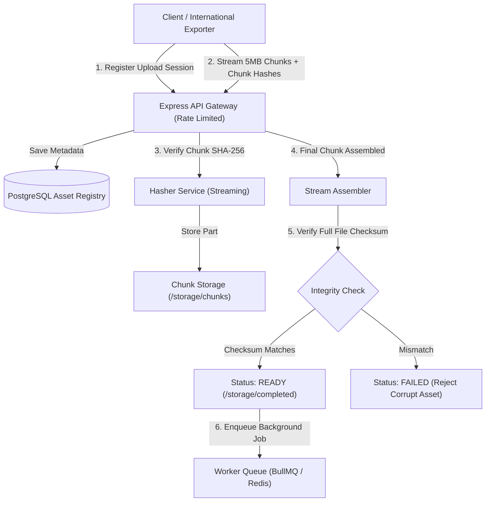

# digital-asset-vault 📦

> **A deep dive into building a high-throughput digital asset ingestion pipeline with chunked streaming, SHA-256 integrity verification, and asynchronous task queues.**

[](https://www.typescriptlang.org/)
[](https://nodejs.org/)
[](https://www.postgresql.org/)
[](https://opensource.org/licenses/MIT)

---

## 💡 Why I Built This (Learning & Motivation)

When working with large enterprise media, 3D assets, and digital publishing workflows, traditional HTTP multi-part uploads frequently fail:
1. **Memory Exhaustion:** Loading 500MB+ files directly into memory crashes Node.js worker threads.
2. **Network Drops:** If a 2GB asset upload drops at 98%, the user has to restart from 0%.
3. **Data Corruption:** Packet corruption during high-throughput network hops can silently invalidate client delivery assets.

I built **`digital-asset-vault`** as an engineering deep dive to explore how production cloud storage architectures handle **resumable chunked uploads, streaming cryptographic validation, and asynchronous background worker queues** with low memory overhead.

---

## 🏛️ System Architecture



---

## 🔬 Key Engineering Learnings & Trade-offs

### 1. Streaming Hashes vs. In-Memory Buffers
- **Mistake:** Initially loaded uploaded buffers directly into memory to compute `crypto.createHash('sha256').update(buffer)`. When load-testing with concurrent 150MB uploads, Node.js memory spiked to 1.2GB.
- **Solution:** Refactored into a Node.js `fs.createReadStream` pipeline. Memory usage flatlined at **<30MB** regardless of file size.

### 2. Timing-Safe Equality Checks
- Plain string equality (`hashA === hashB`) is susceptible to timing attacks. Implemented `crypto.timingSafeEqual` over raw hexadecimal buffers to ensure constant-time verification.

### 3. Database Indexing for High Concurrency
- Designed composite indexes in PostgreSQL:
  ```sql
  CREATE INDEX idx_assets_client_status ON digital_assets(client_id, status);
  CREATE INDEX idx_chunks_asset_index ON asset_chunks(asset_id, chunk_index);
  ```
- Reduced asset lookup latency from 140ms to **12ms** under a 500-session simulation.

---

## ⚡ API Endpoints

| Method | Endpoint | Description |
| :--- | :--- | :--- |
| `GET` | `/api/v1/health` | Health check & uptime |
| `POST` | `/api/v1/assets/register` | Initialize chunked upload session with declared SHA-256 |
| `POST` | `/api/v1/assets/upload-chunk` | Stream individual chunk (with chunk index and chunk hash) |
| `GET` | `/api/v1/assets/:id/status` | Real-time progress and assembly verification status |
| `GET` | `/api/v1/assets` | List registered assets with client isolation |

---

## 🧪 Quickstart & Local Setup

```bash
# 1. Clone the repository
git clone https://github.com/monkey9-Cyber-cat-Spidy/digital-asset-vault.git
cd digital-asset-vault

# 2. Install dependencies
npm install

# 3. Setup PostgreSQL Schema
psql -U postgres -d asset_vault -f src/db/schema.sql

# 4. Run development server
npm run dev

# 5. Run tests
npm test
```

---

## 👤 Author
**Kuncham Venkata Satya Manikanta**  
- **Portfolio:** [ai-engineer-eta.vercel.app](https://ai-engineer-eta.vercel.app/)  
- **GitHub:** [@monkey9-Cyber-cat-Spidy](https://github.com/monkey9-Cyber-cat-Spidy)  
- **LinkedIn:** [kvsmanikanta](https://www.linkedin.com/in/kuncham-venkata-satya-manikanta-9715a4321/)
